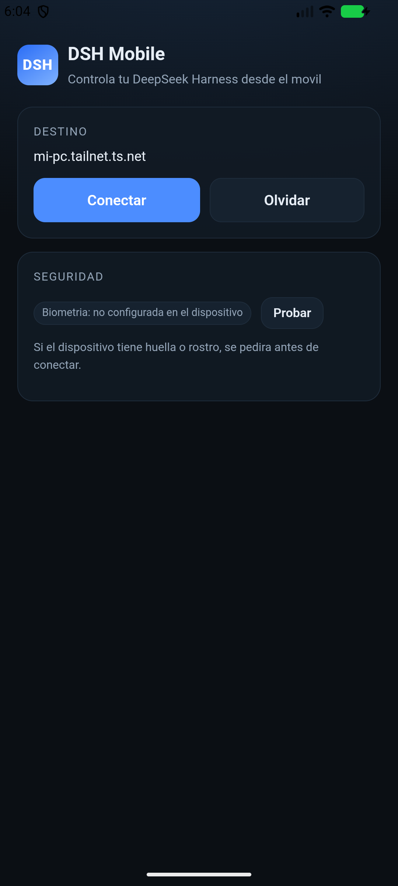
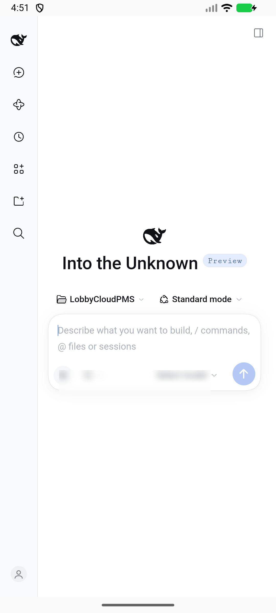

# DSH Mobile

Android app to control **[DeepSeek Harness](https://github.com/deepseek-ai/deepseek-harness)** (DSH) from your phone.

> **Unofficial.** Not affiliated with, endorsed by, or supported by DeepSeek. The name is used nominatively to describe the software this app connects to. DSH is in *developer preview* and may break compatibility.

<p align="center">
  
  
</p>

## What it is

A thin **Capacitor** shell that opens the official DSH Web UI in a native Android WebView, plus what a phone needs:

- **QR pairing** (URL + launch token) or manual URL entry.
- **Optional biometric lock** before connecting.
- **Native navigation plugin** so DSH’s `SameSite=Strict` session cookie is accepted (see [How it works](#how-it-works)).
- Own launcher icon and splash, Android 8+ (minSdk 26).

Agents, models and files stay on your computer: this app is a remote control, not a replacement.

## Requirements

| Where | What |
|---|---|
| Phone | Android 8.0+ |
| Computer | Node.js 24.9+ and DSH web profile (`npx @deepseek-ai/dsh web`) |
| Network | **Tailscale recommended** (phone + PC in the same tailnet, HTTPS via Tailscale Serve). LAN or a TLS tunnel also works |

## Quick start

1. **Run DSH on your PC**

   ```bash
   npx @deepseek-ai/dsh web --no-open --port 3080
   ```

2. **Expose it to your phone** (Tailscale on both devices):

   ```bash
   tailscale serve --bg --https=443 http://127.0.0.1:3080
   npx @deepseek-ai/dsh web --no-open --port 3080 ^
     --trusted-host <machine>.<tailnet>.ts.net ^
     --public-url https://<machine>.<tailnet>.ts.net/
   ```

   Use `^` on Windows cmd, backslash on macOS/Linux. Any HTTPS reverse proxy or LAN address also works (cleartext is allowed for local IPs, HTTPS is safer).

3. **Optional pairing helper** (prints the QR in the terminal):

   ```bash
   npm install
   npm run pair
   ```

4. **Install the app** from [Releases](../../releases) (debug-signed sideload build) or build it, then **scan the QR** and connect.

## Build from source

Requirements: Node.js 24.9+, JDK 21, Android SDK (platform 36, build-tools 36.x). No NDK.

```bash
npm install
npx cap sync android
cd android
./gradlew assembleDebug          # Windows: gradlew.bat assembleDebug
# APK: app/build/outputs/apk/debug/app-debug.apk
```

The Gradle wrapper is pinned to Gradle 9.0.0. App id: `io.github.deimerjr.dshmobile`; change it and the Java package if you fork.

## How it works

- **Capacitor 8** loads a small local shell (`www/index.html`) that handles pairing and biometrics.
- DSH issues its session cookie with `SameSite=Strict`. Navigating from the shell with `location.replace()` is a cross-site navigation, so Chrome drops the cookie at the token redirect.
- The app therefore navigates through a **native plugin** (`OpenUrlPlugin.java` → `WebView.loadUrl`), which behaves like a browser-initiated navigation and sends Strict cookies correctly.
- The launch token is exchanged for an `HttpOnly` cookie; the pairing URL is stored locally so reconnecting works while the DSH process lives. If DSH restarts, pair again (the token rotates).

## Security and privacy

- The QR/URL contains a **process token**: treat it as a credential and do not share it.
- Token and server URL are stored in Android private app storage (Capacitor Preferences).
- **No analytics**, no accounts, no telemetry, no third-party servers: traffic goes to the URL you pair.
- Cleartext HTTP is allowed because tailnet IPs are common during setup; prefer HTTPS.
- Biometrics are a convenience lock, not a security boundary: the real credential is the DSH cookie.

## Limitations

- The DSH Web UI is responsive but desktop-oriented; on a phone it shows the desktop-ish layout.
- No push notifications.
- Android back leaves the remote view; reopen the app to return to pairing.
- No iOS build yet.
- DSH is a developer preview: expect changes.

## Project layout

```text
www/                     pairing shell (HTML/CSS/JS, no bundler)
capacitor.config.json
tools/pair.mjs           cross-platform QR pairing helper
tools/make-icons.py      launcher icon / splash generator
android/                 Capacitor Android project
  app/src/main/java/io/github/deimerjr/dshmobile/
    MainActivity.java    registers the plugin
    OpenUrlPlugin.java   native navigation (SameSite fix)
docs/screenshots/
```

## Contributing

Issues and PRs are welcome. See [CONTRIBUTING.md](CONTRIBUTING.md).

## License

MIT — see [LICENSE](LICENSE). Third-party notices in [THIRD_PARTY_NOTICES.md](THIRD_PARTY_NOTICES.md).

[Leer en español](README.es.md)
